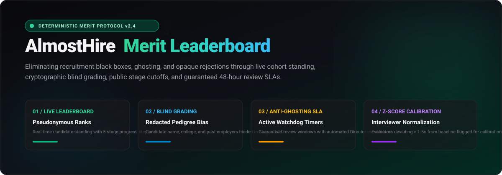
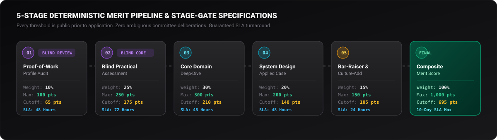
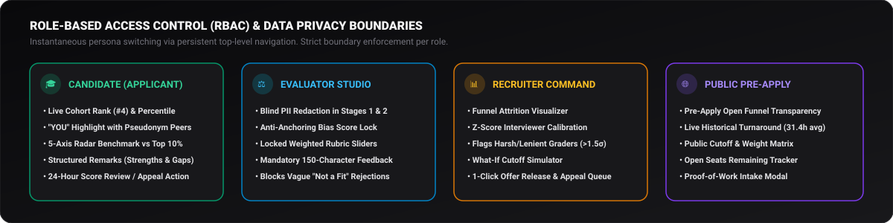
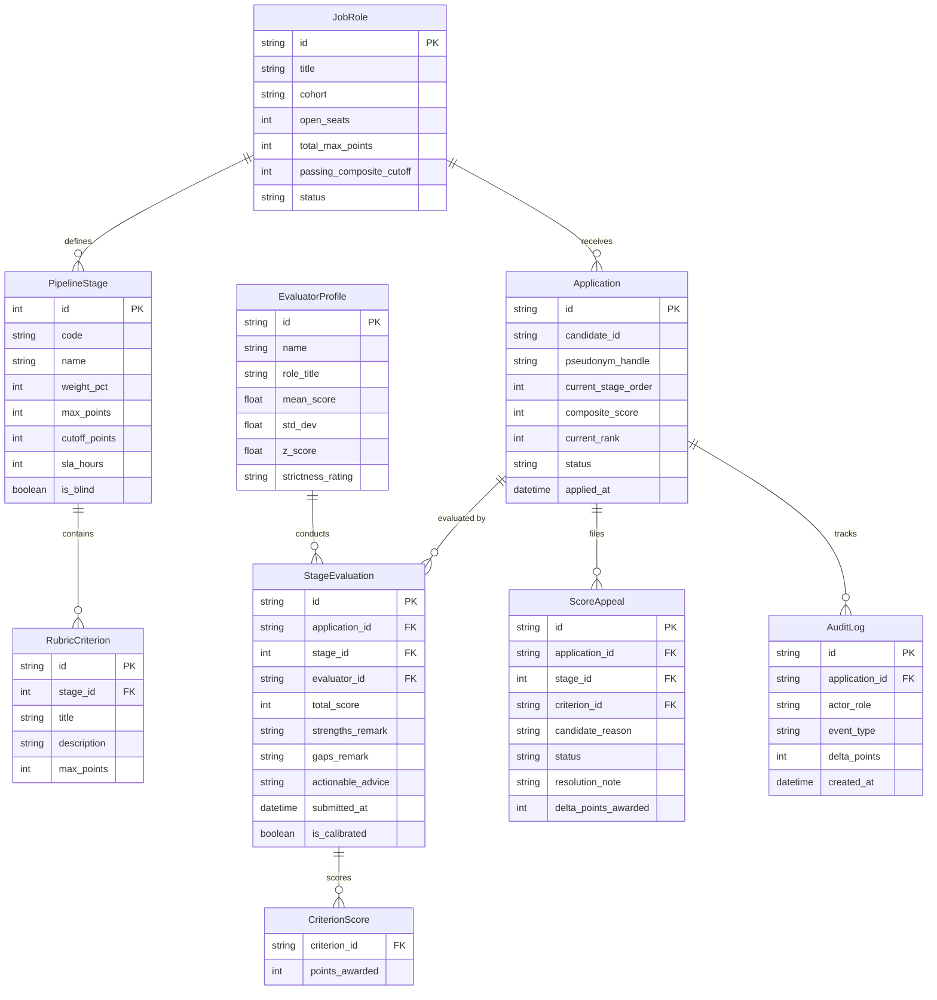

# AlmostHire: Transparent Merit-Based Hiring & Candidate Leaderboard Platform

<div align="center">
  

  <br/><br/>

  [](https://nextjs.org/)
  [](https://react.dev/)
  [](https://www.typescriptlang.org/)
  [](https://tailwindcss.com/)
  [](https://opensource.org/licenses/MIT)

  <br/>

  **Eliminating recruitment black boxes, ghosting, and opaque rejections through live cohort leaderboards, deterministic scoring, cryptographic blind grading, and public SLAs.**
</div>

---

## Table of Contents
1. [Core Mission & System Overview](#1-core-mission--system-overview)
2. [5-Stage Deterministic Merit Pipeline](#2-5-stage-deterministic-merit-pipeline)
3. [Role-Based Access Control (RBAC) Matrix](#3-role-based-access-control-rbac-matrix)
4. [Granular Scoring Rubric & Tie-Breaker Engine](#4-granular-scoring-rubric--tie-breaker-engine)
5. [Anti-Ghosting SLA & Escalation Watchdog](#5-anti-ghosting-sla--escalation-watchdog)
6. [Interviewer Calibration & Z-Score Normalization](#6-interviewer-calibration--z-score-normalization)
7. [Screens & Visual Feature Tour](#7-screens--visual-feature-tour)
8. [Local Installation & Development](#8-local-installation--development)
9. [Step-by-Step Interactive Demo Walkthrough](#9-step-by-step-interactive-demo-walkthrough)
10. [Architecture & Database Entity Relationship](#10-architecture--database-entity-relationship)

---

## 1. Core Mission & System Overview

Traditional tech hiring is fundamentally broken: applicants submit portfolios into opaque ATS black boxes, wait weeks with zero feedback, receive templated *"not a fit"* rejections, and wonder whether pedigree, gender, or recruiter bias dictated the outcome.

**AlmostHire** transforms recruitment into an open, high-trust, deterministic sport:
- **Live Cohort Leaderboard:** Every applicant tracks their real-time rank, composite score, and percentile standing.
- **Strict Pseudonymity:** Candidate privacy is preserved with verified cryptographic handles (`AegisFalcon`, `QuantumNova`, `CAND-8412`), with the candidate's personal profile highlighted as **`YOU`**.
- **Mandatory Constructive Feedback:** Evaluators cannot submit a scorecard without providing minimum 150 characters covering `What Worked (Strengths)`, `Where Points Were Lost (Gaps)`, and `Recommended Next Steps (Actionable Advice)`. Vague rejections (e.g., *"culture mismatch"*, *"not a fit"*) are blocked by validation rules.
- **Hard Stage Gates with Permanent Scorecards:** Even if a candidate misses a stage cutoff, their entire audit log, points breakdown, and improvement roadmap remain permanently accessible.
- **24-Hour Score Appeal Window:** Objective discrepancies (e.g., commit timestamp errors, automated runner test false-negatives) can be formally appealed with cryptographic evidence.

---

## 2. 5-Stage Deterministic Merit Pipeline

<div align="center">
  
</div>

| Stage | Focus & Method | Weight | Max Pts | Cutoff | Review SLA | Privacy Mode | Transparency Output |
| :--- | :--- | :---: | :---: | :---: | :---: | :---: | :--- |
| **Stage 1** | **Proof-of-Work & Profile Audit** | 10% | 100 pts | 65 pts | 48 hrs | **Blind Mode** (Redacts college, former company, gender, location) | Skill match breakdown, GitHub/portfolio audit score, verifier remark |
| **Stage 2** | **Blind Practical Assessment** | 25% | 250 pts | 175 pts | 72 hrs | **Blind Mode** (Automated runner + masked reviewer) | Test-case pass rate, code quality score, speed efficiency bonus, detailed critique |
| **Stage 3** | **Core Domain Deep-Dive** | 30% | 300 pts | 210 pts | 48 hrs | Unmasked Technical Panel | Criterion-by-criterion interviewer scores, strengths, and missed signals |
| **Stage 4** | **System Design / Applied Case** | 20% | 200 pts | 140 pts | 48 hrs | Unmasked Technical Panel | Architecture trade-off scorecard, scalability rating, panel notes |
| **Stage 5** | **Bar-Raiser & Culture-Add** | 15% | 150 pts | 105 pts | 24 hrs | Independent Bar-Raiser | Ownership, collaboration, and leadership calibration score + final decision note |
| **TOTAL** | **Composite Merit Score** | **100%** | **1,000 pts** | **695 pts** | **10 Days** | **Aggregate** | **Live Rank, Percentile, Stage Badges, Full Immutable Audit Log** |

---

## 3. Role-Based Access Control (RBAC) Matrix

<div align="center">
  
</div>

The platform incorporates a persistent top-level role switcher allowing seamless transitions between 4 key personas:

1. **Candidate (Applicant) View:**
   - Highlights personal standing (`Alex Rivera — Rank #4`), percentile (`Top 12.5%`), and active Stage 5 review countdown SLA.
   - Cohort leaderboard with peer handles pseudononymized.
   - Slide-over transparency drawer with 5-axis Radar Benchmark Chart, granular rubric items, and immutable audit trail.
   - Score Appeal Modal with evidence attachments.
2. **Evaluator / Interviewer Studio:**
   - Split-screen workspace: Candidate dossier (with PII redacted in blind stages) on the left; locked rubric sliders on the right.
   - Anti-anchoring protocol: Peer scores hidden until own submission is sealed.
   - Real-time score calculation and instant leaderboard re-ranking.
3. **Recruiter / Hiring Manager Command:**
   - Funnel attrition visualization (drop-off per stage).
   - Evaluator Z-Score Calibration (detects graders deviating $> \pm 1.5\sigma$).
   - One-Click Cutoff Simulator (simulate adjustments to Stage 1–5 cutoffs and preview Offer Zone impact).
   - Formal Offer Release trigger with celebratory confetti.
   - Candidate Score Appeals Review Queue.
4. **Public Pre-Apply Transparency View:**
   - Public view for prospective applicants: applicant counts, stage cutoffs, historical average turnaround times (avg. 31.4 hours), open seats remaining, and "Apply with Verified Proof-of-Work" demo modal.

---

## 4. Granular Scoring Rubric & Tie-Breaker Engine

### Mathematical Formula:
$$\text{Composite Score} = \sum_{i=1}^{5} \text{Stage Points}_i + \text{Verified Speed Bonuses}$$

$$\text{Passing Threshold} = 695 \text{ pts} \quad (69.5\% \text{ aggregate minimum})$$

### Granular Criteria Breakdown:
1. **Stage 1: Proof-of-Work & Profile Audit (100 pts)**
   - Verifiable Project / Outcome Depth (0–40 pts)
   - Core Tech / Domain Stack Alignment (0–35 pts)
   - Documentation, Open-Source, or Portfolio Clarity (0–25 pts)
2. **Stage 2: Blind Practical Assessment (250 pts)**
   - Functional Accuracy & Edge-Case Coverage (0–100 pts)
   - Craft, Maintainability & Structural Quality (0–80 pts)
   - Clarity of Reasoning / README / Assumptions (0–40 pts)
   - Early Submission Efficiency Bonus (0–30 pts; awarded for submissions within the first 50% of SLA window)
3. **Stage 3: Core Domain Deep-Dive (300 pts)**
   - First-Principles Problem Solving (0–120 pts)
   - Execution Speed & Debugging / Iteration Agility (0–90 pts)
   - Trade-off Articulation & Communication (0–90 pts)
4. **Stage 4: System Design / Applied Case Study (200 pts)**
   - Constraints, Scale & Risk Handling (0–80 pts)
   - User / Business Impact Alignment (0–60 pts)
   - Structured Thinking Under Ambiguity (0–60 pts)
5. **Stage 5: Bar-Raiser & Culture-Add (150 pts)**
   - Extreme Ownership & Accountability Signals (0–60 pts)
   - Cross-Functional Empathy & Collaboration (0–50 pts)
   - Coachability & Learning Velocity (0–40 pts)

### Tie-Breaker Logic:
If two candidates hold identical composite scores, rank is determined sequentially by:
1. Highest Stage 3 + Stage 4 combined score
2. Highest Stage 2 practical score
3. Earlier stage completion timestamp

---

## 5. Anti-Ghosting SLA & Escalation Watchdog

To prevent recruitment ghosting, every stage has an active countdown timer tied to guaranteed review SLAs:
- Active SLA countdown displayed on the Candidate KPI strip (`21h 42m remaining for Stage 5 Review`).
- If an evaluator breaches the SLA window, the candidate receives an automated status notification, and the review is auto-escalated to the Director of Engineering (demonstrated with candidate `ChronosGate`).

---

## 6. Interviewer Calibration & Z-Score Normalization

The Recruiter Command Center tracks each interviewer's mean score ($\mu_i$) and standard deviation ($\sigma_i$) against cohort baselines:

$$Z_i = \frac{\mu_i - \bar{\mu}_{\text{cohort}}}{\sigma_{\text{cohort}}}$$

- **Harsh Evaluators:** $Z_i < -1.5$ (e.g. Marcus Vance at $-1.68\sigma$) are flagged with mandatory calibration warnings.
- **Lenient Evaluators:** $Z_i > +1.5$ (e.g. Elena Rostova at $+1.58\sigma$) are flagged for review before scores are sealed.
- **Calibrated Evaluators:** Evaluators within $\pm 1.0\sigma$ maintain standard grading status.

---

## 7. Screens & Visual Feature Tour

### 1. Live Cohort Leaderboard (Candidate View)
- **Top KPI Strip:** Total Cohort Pool, Active Pipeline, Offer Zone Seats, Your Standing (`#4`), Percentile (`Top 12.5%`), and Stage 5 SLA Countdown Timer.
- **Interactive Leaderboard Table:** Columns for Rank & Trend (`▲1`), Candidate Pseudonym (`AegisSeeker (YOU)`), 5-Node Stage Stepper, Stage Points Mini Bars, Composite Score (`/1000`), Latest Evaluator Remark Preview, and Status Badge (`Offer Zone`, `Advancing`, `Cutoff Missed`).
- **Filters & Search:** Filter by Status (`Offer Zone`, `Advancing`, `Cutoff Missed`), Cleared Stage (1–5), or search by Candidate Handle.

### 2. Candidate Scorecard & Transparency Drawer
- **5-Axis Radar Chart:** Recharts radar comparing candidate's sub-metric scores against the **Cohort Average** and **Top 10% Benchmark**.
- **Stage Accordion Cards:** Exact points per sub-criterion, evaluator role, timestamp, and mandatory remarks (`What Worked`, `Where Points Were Lost`, `Recommended Next Steps`).
- **Immutable Audit Trail:** Chronological feed of every submission, evaluation, score update, and rank movement.
- **Score Appeal Modal:** 24-hour dispute form citing objective rubric evidence.

### 3. Evaluator Studio
- **Blind Dossier:** Candidate PII redacted during Stages 1 & 2.
- **Locked Rubric Sliders:** Interactive range sliders with auto-calculated weighted points.
- **Mandatory Character Counter:** Requires minimum 150 characters total across remarks.
- **Anti-Vague Rejection Engine:** Blocks phrases like *"not a fit"*, *"bad vibe"*, etc.

### 4. Recruiter Command Center
- **Funnel Conversion:** Stage drop-off rates and step-pass percentages.
- **Evaluator Calibration:** Strictness ratings, mean scores, standard deviations, and Z-score flags.
- **One-Click Cutoff Simulator:** Interactive sliders allowing recruiters to adjust stage cutoffs and preview Offer Zone impact in real time.
- **Formal Offer Trigger:** Releases offer package with celebratory confetti animation and audit log recording.

### 5. Pre-Apply Public View
- Pre-apply public funnel stats, 31.4-hour historical turnaround average, 5-stage specification matrix, and interactive intake demo modal.

---

## 8. Local Installation & Development

### Prerequisites:
- Node.js 18.x or later (tested on v24.22.1)
- npm 9.x or later

### Installation:
```bash
# 1. Clone the repository
git clone https://github.com/almostalok/almosthire.git
cd almosthire

# 2. Install dependencies
npm install

# 3. Start development server
npm run dev

# 4. Open in browser
# Navigate to http://localhost:3000
```

### Production Build:
```bash
npm run build
npm start
```

---

## 9. Step-by-Step Interactive Demo Walkthrough

1. **Candidate View:**
   - Open [http://localhost:3000](http://localhost:3000).
   - In **Candidate View**, observe your status as **Alex Rivera (`AegisSeeker (YOU)`)** at **Rank #4 (785 / 1000 pts)**, just 81 points behind the Offer Zone.
   - Click your row to open the **Candidate Scorecard & Transparency Drawer**: inspect the 5-axis Radar Chart, granular rubric points, and immutable audit log.
2. **Evaluator Studio & Live Reactivity:**
   - Click **Evaluator Studio** in the top navigation switcher.
   - Notice candidate **Alex Rivera** is selected for **Stage 5 (Bar-Raiser)** review.
   - Inspect the locked sliders and pre-filled constructive feedback.
   - Click **Submit & Publish Scorecard**.
   - **Observe live reactivity:** A toast notification alerts you that the scorecard has been sealed and ranks recalculated.
   - Switch back to **Candidate View**: Alex Rivera has automatically jumped from **Rank #4** into **Rank #2** in the **Offer Zone** with **910 / 1000 pts**!
3. **Recruiter Command Center:**
   - Switch to **Recruiter Admin**.
   - Inspect the **Evaluator Z-Score Calibration** tab to see harsh/lenient flags.
   - Click **Cutoff Simulator** and drag the Stage 3 slider from 210 to 225 to see dynamic changes.
   - Click **Release Formal Offer** for any Offer Zone leader to trigger the confetti celebration.
4. **Candidate Appeals:**
   - In the Recruiter Dashboard under **Candidate Appeals Queue**, inspect pending appeals and click **Approve (+10 pts)** or **Decline Appeal** with formal panel notes.
5. **Public Transparency View:**
   - Switch to **Public View** to see what prospective candidates see before submitting their applications.

---

## 10. Architecture & Database Entity Relationship



---

## License

This project is licensed under the [MIT License](LICENSE).
